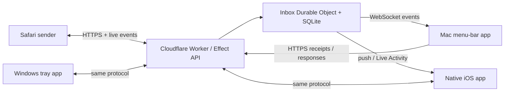

# Shouldertap architecture

October 2026. The [Notion concept document](https://www.notion.so/3eb7155b453881c7bc4cdc8ef57d87e2) is the product source of truth. [README](../README.md) describes what ships today and how to run it. [Design system](design.md) governs UI.

## Current system

| Surface | Location | Role |
| --- | --- | --- |
| API + Durable Objects | `apps/server` | Effect `HttpApi`, Inbox, SenderPatron and historical TrialLedger DOs, Drizzle on DO SQLite |
| Safari sender + marketing | `apps/web` | React, TanStack Router, Vite; deployed via Alchemy `Website` |
| Mac receiver | `apps/macos` | Swift package (`ShouldertapCore` + AppKit menu-bar app) |
| iOS sender + receiver features | `apps/ios` | SwiftUI Xcode app; links `ShouldertapCore` from `apps/macos` |
| Windows receiver | `apps/windows` | Rust `shouldertap-core` + GPUI tray app |
| Contracts + client | `packages/domain`, `packages/client` | Effect Schema, HttpApi spec, live WebSocket client |
| Infrastructure | `alchemy.run.ts` (repo root) | Alchemy v2 stack: Workers, assets, bindings, stages |

**Wire protocol:** JSON over HTTPS and WebSocket events. The server and `packages/domain` are authoritative. The same shapes are mirrored manually in `ShouldertapCore` (Swift) and `shouldertap-core` (Rust). `scripts/check-protocol-sync.mjs` runs in `bun run check` to keep swatches and length limits aligned.

**Auth / accounts:** Invite-link pairing with bearer credentials owned by each Inbox DO. A sender's patron membership is a separate SenderPatron DO with its own bearer keys (never a pairing credential), so one membership spans pairings. Better Auth uses D1 for email accounts, sessions, and ownership references. Inbox and SenderPatron DOs remain authoritative for messaging and membership. See [email accounts](accounts.md).

## Runtime topology



The API authorizes WebSocket upgrades and routes them to the recipient Inbox. Commands use HTTPS; sockets carry server events. Senders never choose an arbitrary recipient: pairing grants scope. Reconnect resyncs durable state.

## Message facts

1. **Accepted:** stored on the server.
2. **Displayed:** a connected device reports presenting the tap. iPhone reports its foreground takeover; background APNs acceptance alone is not a display receipt.
3. **Acknowledged:** the recipient explicitly responded.

One valid response dismisses every connected display. Idempotency keys protect sends; event IDs support resync after disconnect.

## Where Effect belongs

- **Domain / server:** schemas, policies, `HttpApi` handlers, DO RPC, typed errors.
- **Clients:** decode, retry, reconnect, acknowledgement sync; native UI stays native.
- **Infra:** Alchemy resource graph and deploy stages (`prod`, `pr-<n>`, `dev`).

Hono (if present) stays at transport boundaries; application policy lives in Effect services.

## Repository layout

```text
alchemy.run.ts
apps/server/     Worker + Inbox + TrialLedger
apps/web/        Safari sender site
apps/macos/      Swift Mac app + ShouldertapCore (outside Bun workspaces)
apps/ios/        Swift iOS app (Xcode)
apps/windows/    Rust core + GPUI app
packages/domain/
packages/client/
stacks/          GitHub / Cloudflare admin stacks
scripts/         Deploy helpers, protocol sync check
docs/
```

Do not add `apps/api` (server is `apps/server`). Do not share server auth packages into app bundles.

## Quality gates

- **TypeScript:** `bun run check` (Ultracite + protocol sync), `bun run check-types`, `bun run test`.
- **Integration:** Alchemy `Test` harness in `apps/server/test` (local + PR preview deploy).
- **Browser:** Playwright download flow only (`apps/web/e2e`); scope documented in `apps/web/e2e/README.md`.
- **Native:** `swift test` in `apps/macos` and `cargo test -p shouldertap-core` in `apps/windows` on path-filtered CI (`.github/workflows/native.yml`; full workspace on Windows in `windows-release.yml`).

## Research and history

Generator choices, Effect 4 / Alchemy beta notes, and early scaffolding rationale live under `docs/research/`. Those documents may lag `README.md`; prefer README and this file for the current tree.

## Optional patron support

Core messaging has no billing gate. `plan.status = paid` is the compatibility value for older clients; it is independent of actual purchase records. Patron support belongs to the **sender**: the SenderPatron DO folds signed Creem facts (metadata `patron_id`) and answers whether a presented patron key is active. The Worker turns a send's requested theme into a `VerifiedTheme` from that answer alone, and the Inbox stores it on the tap (`taps.theme`); anything else stores Default and still delivers. Recipients can reduce animation motion; tap styling belongs to the sender. Historical receiver subscriptions (metadata `inbox_id`) still fold in their Inbox for management and refunds and grant nothing. See [patrons.md](patrons.md).

An iPhone can create an inbox independently; computers are optional. The sender owns theme entitlement in SenderPatron, while every recipient may reduce motion. New sender checkout defaults off until approved; native iPhone billing links use the actual US App Store storefront.
